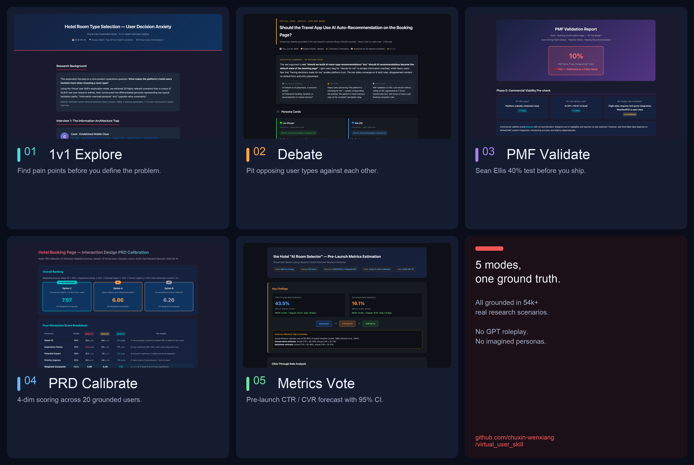

# Live Demos — virtual_user_skill in Action

Five real research scenarios run end-to-end with virtual_user_skill, one per working mode.
All reports are **fully anonymized** — business identifiers replaced with generic terms like *"the platform"*, *"hotel app"*, *"the booking page"*.



## The 5 reports

| Mode | Report | What it shows |
|------|--------|---------------|
| 🔭 **1v1 Explore** | [`explore-1v1-EN.html`](./explore-1v1-EN.html) | Two grounded interviews on hotel room-type anxiety — including a moment where the virtual user **rejects** the persona setup mid-interview ("Actually, I don't travel that often, and I never said I expense them.") |
| 🥊 **Debate** | [`debate-EN.html`](./debate-EN.html) | A heavy traveler vs. a light traveler debating whether the app should auto-recommend rooms. The roles you'd predict are reversed — the heavy user is *against*, the light user is *for*. |
| ✅ **PMF Validate** | [`pmf-EN.html`](./pmf-EN.html) | Sean Ellis 40% test on an "AI trip butler" with 20 grounded users. Result: 10% — well below threshold. Only 1/20 was "very disappointed," and she'd actually lost money to a flight delay. Feature killed, 3 months of eng saved. |
| 📐 **PRD Calibrate** | [`prd-EN.html`](./prd-EN.html) | 3 design options × 20 evaluators × 4 dimensions (need / clarity / impact / urgency). Standard deviation reveals polarization that averages hide. |
| 📊 **Metrics Vote** | [`metrics-EN.html`](./metrics-EN.html) | Pre-launch CTR / CVR forecast with 50 grounded virtual users. Juster (1966) intention-behavior gap baked in. VIP vs regular gap (18.8pp) matches OTA industry benchmark. |

## How these were generated

```
1. virtual_user_skill retrieves grounded virtual users from 54,000+ real research scenarios (768-dim vector search).
2. The AI researcher runs one of the 5 modes on a real product question.
3. Reports are exported as standalone HTML (dark theme, fully self-contained, no external deps).
```

No GPT roleplay. No imagined personas. Just retrieved + reconstructed real user voices.

→ Back to [main README](../README.md)
